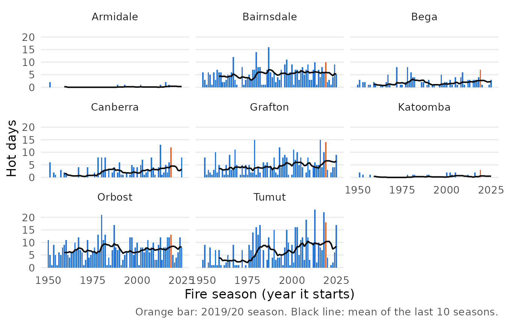

# Getting started with bushfireheat

bushfireheat is for risk analysts who price bushfire exposure in
south-eastern Australia. It answers one question: how much more often
does extreme heat occur in the fire season now than in 1950–1979, and
does the answer depend on where the threshold for “extreme” is set?

## Install and load

``` r

# install.packages("remotes")
remotes::install_github("ETC5523-2026/etc5523-assignment-4-hanwen-l")
```

``` r

library(bushfireheat)
```

## Launch the app

``` r

run_app()
```

Choose one or more towns and a hot-day threshold in the sidebar. The
chart shows how many days in each fire season reached the threshold, and
the table compares the 1950–79 baseline with 1996–2025.

## The data

`fire_daily` has one row per town and day, for every day of every
September–February fire season since 1950/51. A season is labelled by
the year it starts, so `season == 2019` is the 2019/20 Black Summer.

``` r

fire_towns
#>         town state    lat    lon grid_lat grid_lon elevation
#> 1   Armidale   NSW -30.51 151.67   -30.50   151.75       985
#> 2 Bairnsdale   VIC -37.82 147.63   -37.75   147.75         2
#> 3       Bega   NSW -36.67 149.84   -36.75   149.75        11
#> 4   Canberra   ACT -35.28 149.13   -35.25   149.25       574
#> 5    Grafton   NSW -29.69 152.93   -29.75   153.00         8
#> 6   Katoomba   NSW -33.71 150.31   -33.75   150.25      1019
#> 7     Orbost   VIC -37.70 148.46   -37.75   148.50        45
#> 8      Tumut   NSW -35.30 148.22   -35.25   148.25       272
head(fire_daily)
#>       town season       date tmax rain
#> 1 Armidale   1950 1950-09-01 18.0    0
#> 2 Armidale   1950 1950-09-02 13.3    0
#> 3 Armidale   1950 1950-09-03  9.4    0
#> 4 Armidale   1950 1950-09-04 12.3    0
#> 5 Armidale   1950 1950-09-05 15.1    0
#> 6 Armidale   1950 1950-09-06 16.0    0
```

## Count hot days and compare periods

[`summarise_seasons()`](https://etc5523-2026.github.io/etc5523-assignment-4-hanwen-l/reference/summarise_seasons.md)
counts the days in each season that reached the threshold, and
[`compare_periods()`](https://etc5523-2026.github.io/etc5523-assignment-4-hanwen-l/reference/compare_periods.md)
averages them over two periods.

``` r

seasons <- summarise_seasons(fire_daily, threshold = 35)
comparison <- compare_periods(seasons)
comparison
#> # A tibble: 8 × 8
#>   town       baseline_hot_days recent_hot_days ratio reliable baseline_total
#>   <chr>                  <dbl>           <dbl> <dbl> <lgl>             <int>
#> 1 Armidale              0.0667           0.167  2.5  FALSE                 2
#> 2 Bairnsdale            4.2              5.9    1.40 TRUE                126
#> 3 Bega                  1.5              2.07   1.38 TRUE                 45
#> 4 Canberra              1.1              3.27   2.97 TRUE                 33
#> 5 Grafton               3.77             5.4    1.43 TRUE                113
#> 6 Katoomba              0.167            0.433  2.6  FALSE                 5
#> 7 Orbost                6.6              7.77   1.18 TRUE                198
#> 8 Tumut                 3.53             9.07   2.57 TRUE                106
#> # ℹ 2 more variables: baseline_rain <dbl>, recent_rain <dbl>
```

In Canberra, a fire season averaged 1.1 days at or above 35 °C in
1950–79 and 3.3 in 1996–2025, about 3 times as many. Average fire-season
rainfall barely changed, from 327 mm to 317 mm.

``` r

plot_hot_days(seasons)
```



## Check the threshold

A higher threshold gives a larger ratio, but from fewer days. When the
baseline has fewer than 10 hot days in total, `reliable` is `FALSE` and
the ratio should not be read on its own.

``` r

compare_periods(summarise_seasons(fire_daily, threshold = 38))
#> # A tibble: 8 × 8
#>   town       baseline_hot_days recent_hot_days ratio reliable baseline_total
#>   <chr>                  <dbl>           <dbl> <dbl> <lgl>             <int>
#> 1 Armidale              0                0     NA    FALSE                 0
#> 2 Bairnsdale            1.23             2.4    1.95 TRUE                 37
#> 3 Bega                  0.1              0.4    4    FALSE                 3
#> 4 Canberra              0.0667           0.267  4    FALSE                 2
#> 5 Grafton               0.567            0.967  1.71 TRUE                 17
#> 6 Katoomba              0                0     NA    FALSE                 0
#> 7 Orbost                2.17             3.17   1.46 TRUE                 65
#> 8 Tumut                 0.633            2.77   4.37 TRUE                 19
#> # ℹ 2 more variables: baseline_rain <dbl>, recent_rain <dbl>
```

## Limitations

The data are ERA5 grid-cell values, about 25 km across, rather than
weather station readings, and they measure heat and rain, not fire
weather indices, fuel or ignition.
