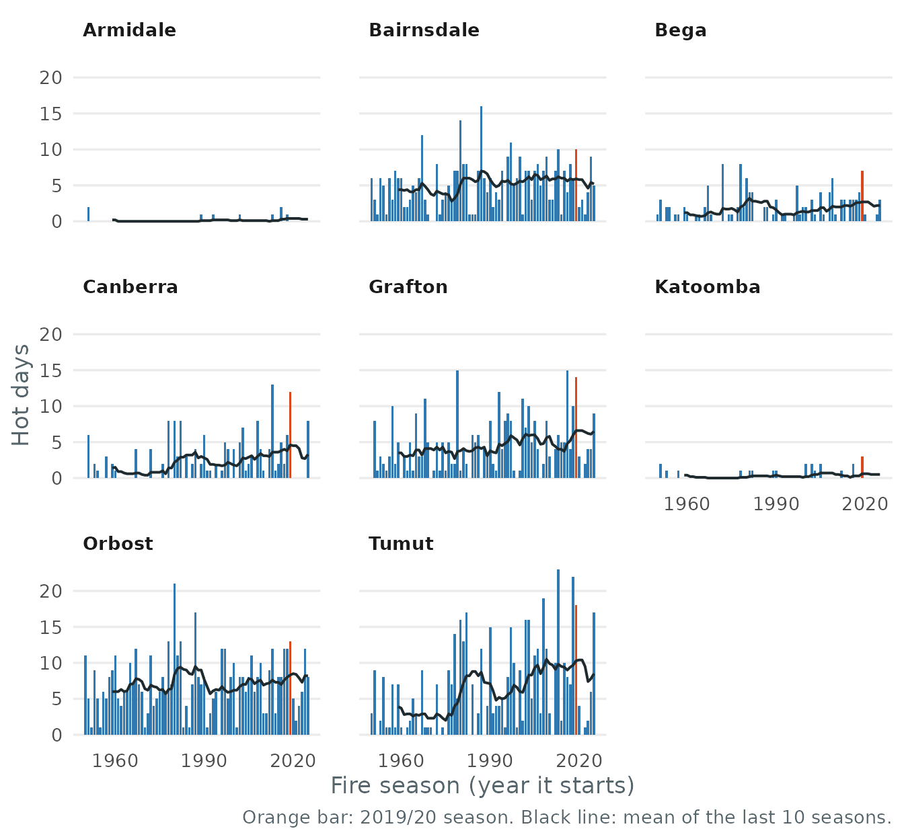

# Getting started with bushfireheat

bushfireheat is for risk analysts who price bushfire exposure in
south-eastern Australia. It answers one question: how much more often
does extreme heat occur in the fire season now than in 1950–1979, and
does the answer depend on where the threshold for “extreme” is set?

## Install and load

``` r

# install.packages("remotes")
remotes::install_github("ETC5523-2026/etc5523-assignment-4-hanwen-l")
```

``` r

library(bushfireheat)
```

## Launch and use the app

``` r

run_app()
```


The app has two tabs. **Explore** is where you work, and **How to use**
defines every term and lists the data’s limitations. On the Explore tab:

1.  Pick one or more towns in **Towns**.
2.  Set the **Hot-day threshold**. A hot day is a day whose maximum
    temperature reaches it.
3.  Read the headline. It answers the question for your selection: how
    many times as common days at or above the threshold are in 1996–2025
    as in 1950–79, across the towns with enough data. The sentence below
    it compares rainfall over the same seasons.
4.  Read the chart and table for the detail behind the headline.
5.  Move the threshold up and down to see whether the answer depends on
    it.

## Interpret the outputs

**The headline.** With the four towns in the screenshot at 35 °C, days
that hot are now 1.2 to 3.0 times as common as in 1950–79. Inland towns
show the largest rises (Canberra 3.0×, Tumut 2.6×) and Orbost the
smallest (1.2×). Average fire-season rainfall changed by between -3% and
+2%, so the extra heat has not come with drier seasons.

**The chart.** Each panel is one town and each bar one fire season, on a
shared scale. The orange bar is 2019/20, the Black Summer, and the black
line averages the previous 10 seasons. Where the line climbs after the
1990s, hot days have become more common; in Canberra and Tumut, 2019/20
is among the hottest seasons on record but not an outlier against recent
years.

**The table.** It gives each town’s average hot days per season in both
periods, their ratio and the change in rainfall.

**What this means for the question.** Loadings built on 1950–79
experience would understate how often these towns now see fire-season
heat, and the change comes from heat rather than drought.

**When a town is left out.** A town needs at least 10 hot days in
1950–79 for its ratio to be stable. Highland towns rarely reach 35 °C,
so if you add Armidale or Katoomba the headline leaves them out, names
them, and the table shows a dash. Lower the threshold to about 32 °C to
include them.

## The data

`fire_daily` has one row per town and day, for every day of every
September–February fire season since 1950/51. A season is labelled by
the year it starts, so `season == 2019` is the 2019/20 Black Summer.

``` r

fire_towns
#> # A tibble: 8 × 7
#>   town       state   lat   lon grid_lat grid_lon elevation
#>   <chr>      <chr> <dbl> <dbl>    <dbl>    <dbl>     <dbl>
#> 1 Armidale   NSW   -30.5  152.    -30.5     152.       985
#> 2 Bairnsdale VIC   -37.8  148.    -37.8     148.         2
#> 3 Bega       NSW   -36.7  150.    -36.8     150.        11
#> 4 Canberra   ACT   -35.3  149.    -35.2     149.       574
#> 5 Grafton    NSW   -29.7  153.    -29.8     153          8
#> 6 Katoomba   NSW   -33.7  150.    -33.8     150.      1019
#> 7 Orbost     VIC   -37.7  148.    -37.8     148.        45
#> 8 Tumut      NSW   -35.3  148.    -35.2     148.       272
head(fire_daily)
#> # A tibble: 6 × 5
#>   town     season date        tmax  rain
#>   <chr>     <int> <date>     <dbl> <dbl>
#> 1 Armidale   1950 1950-09-01  18       0
#> 2 Armidale   1950 1950-09-02  13.3     0
#> 3 Armidale   1950 1950-09-03   9.4     0
#> 4 Armidale   1950 1950-09-04  12.3     0
#> 5 Armidale   1950 1950-09-05  15.1     0
#> 6 Armidale   1950 1950-09-06  16       0
```

## Use the functions directly

The app is built on three exported functions.
[`summarise_seasons()`](https://etc5523-2026.github.io/etc5523-assignment-4-hanwen-l/reference/summarise_seasons.md)
counts the days in each season that reached the threshold,
[`compare_periods()`](https://etc5523-2026.github.io/etc5523-assignment-4-hanwen-l/reference/compare_periods.md)
averages them over the two periods, and
[`plot_hot_days()`](https://etc5523-2026.github.io/etc5523-assignment-4-hanwen-l/reference/plot_hot_days.md)
draws the chart.

``` r

seasons <- summarise_seasons(fire_daily, threshold = 35)
compare_periods(seasons)
#> # A tibble: 8 × 8
#>   town       baseline_hot_days recent_hot_days ratio reliable baseline_total
#>   <chr>                  <dbl>           <dbl> <dbl> <lgl>             <int>
#> 1 Armidale              0.0667           0.167  2.5  FALSE                 2
#> 2 Bairnsdale            4.2              5.9    1.40 TRUE                126
#> 3 Bega                  1.5              2.07   1.38 TRUE                 45
#> 4 Canberra              1.1              3.27   2.97 TRUE                 33
#> 5 Grafton               3.77             5.4    1.43 TRUE                113
#> 6 Katoomba              0.167            0.433  2.6  FALSE                 5
#> 7 Orbost                6.6              7.77   1.18 TRUE                198
#> 8 Tumut                 3.53             9.07   2.57 TRUE                106
#> # ℹ 2 more variables: baseline_rain <dbl>, recent_rain <dbl>
```

``` r

plot_hot_days(seasons)
```



A higher threshold gives a larger ratio, but from fewer days. When the
baseline has fewer than 10 hot days in total, `reliable` is `FALSE` and
the ratio should not be read on its own.

``` r

compare_periods(summarise_seasons(fire_daily, threshold = 38))
#> # A tibble: 8 × 8
#>   town       baseline_hot_days recent_hot_days ratio reliable baseline_total
#>   <chr>                  <dbl>           <dbl> <dbl> <lgl>             <int>
#> 1 Armidale              0                0     NA    FALSE                 0
#> 2 Bairnsdale            1.23             2.4    1.95 TRUE                 37
#> 3 Bega                  0.1              0.4    4    FALSE                 3
#> 4 Canberra              0.0667           0.267  4    FALSE                 2
#> 5 Grafton               0.567            0.967  1.71 TRUE                 17
#> 6 Katoomba              0                0     NA    FALSE                 0
#> 7 Orbost                2.17             3.17   1.46 TRUE                 65
#> 8 Tumut                 0.633            2.77   4.37 TRUE                 19
#> # ℹ 2 more variables: baseline_rain <dbl>, recent_rain <dbl>
```

## Limitations

The data are ERA5 grid-cell values, about 25 km across, rather than
weather station readings, so they smooth out local extremes. They
measure heat and rain only, not fire weather indices, wind, fuel or
ignition.
