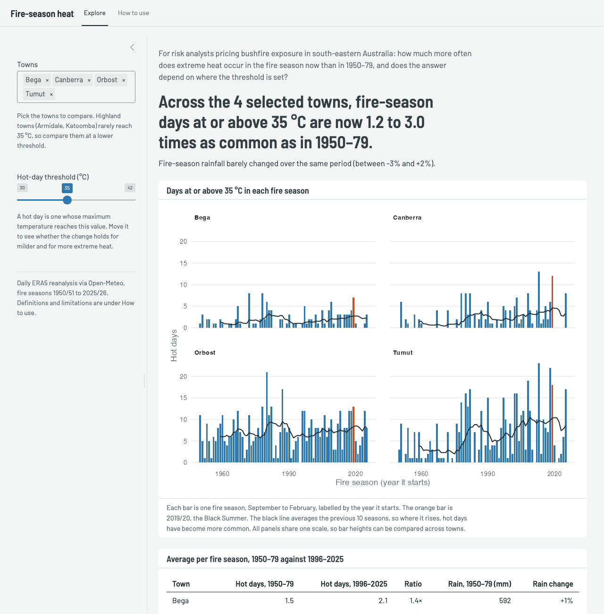

```{r, include = FALSE}
knitr::opts_chunk$set(
  collapse = TRUE,
  comment = "#>",
  fig.width = 7,
  fig.height = 4.5
)
```

bushfireheat is for risk analysts who price bushfire exposure in south-eastern
Australia. It answers one question: how much more often does extreme heat
occur in the fire season now than in 1950–1979, and does the answer depend on
where the threshold for "extreme" is set?

## Install and load

```{r, eval = FALSE}
# install.packages("remotes")
remotes::install_github("ETC5523-2026/etc5523-assignment-4-hanwen-l")
```

```{r setup}
library(bushfireheat)
```

## Launch and use the app

```{r, eval = FALSE}
run_app()
```

```{r, echo = FALSE, out.width = "100%", fig.alt = "The Explore tab of the app, with four towns selected at a 35 °C threshold."}

```

The app has two tabs. **Explore** is where you work, and **How to use**
defines every term and lists the data's limitations. On the Explore tab:

1. Pick one or more towns in **Towns**.
2. Set the **Hot-day threshold**. A hot day is a day whose maximum temperature
   reaches it.
3. Read the headline. It answers the question for your selection: how many
   times as common days at or above the threshold are in 1996–2025 as in
   1950–79, across the towns with enough data. The sentence below it compares
   rainfall over the same seasons.
4. Read the chart and table for the detail behind the headline.
5. Move the threshold up and down to see whether the answer depends on it.

## Interpret the outputs

```{r, include = FALSE}
default_towns <- c("Bega", "Canberra", "Orbost", "Tumut")
shown <- compare_periods(summarise_seasons(fire_daily, 35, default_towns))
ratio <- setNames(sprintf("%.1f", shown$ratio), shown$town)
ratio_range <- sprintf("%.1f", range(shown$ratio))
rain_range <- sprintf("%+.0f%%", range(100 * (shown$recent_rain / shown$baseline_rain - 1)))
```

**The headline.** With the four towns in the screenshot at 35 °C, days that
hot are now `r ratio_range[1]` to `r ratio_range[2]` times as common as in
1950–79. Inland towns show the largest rises (Canberra `r ratio[["Canberra"]]`×,
Tumut `r ratio[["Tumut"]]`×) and Orbost the smallest (`r ratio[["Orbost"]]`×).
Average fire-season rainfall changed by between `r rain_range[1]` and
`r rain_range[2]`, so the extra heat has not come with drier seasons.

**The chart.** Each panel is one town and each bar one fire season, on a shared
scale. The orange bar is 2019/20, the Black Summer, and the black line averages
the previous 10 seasons. Where the line climbs after the 1990s, hot days have
become more common; in Canberra and Tumut, 2019/20 is among the hottest
seasons on record but not an outlier against recent years.

**The table.** It gives each town's average hot days per season in both
periods, their ratio and the change in rainfall.

**What this means for the question.** Loadings built on 1950–79 experience
would understate how often these towns now see fire-season heat, and the
change comes from heat rather than drought.

**When a town is left out.** A town needs at least 10 hot days in 1950–79 for
its ratio to be stable. Highland towns rarely reach 35 °C, so if you add
Armidale or Katoomba the headline leaves them out, names them, and the table
shows a dash. Lower the threshold to about 32 °C to include them.

## The data

`fire_daily` has one row per town and day, for every day of every
September–February fire season since 1950/51. A season is labelled by the
year it starts, so `season == 2019` is the 2019/20 Black Summer.

```{r}
fire_towns
head(fire_daily)
```

## Use the functions directly

The app is built on three exported functions. `summarise_seasons()` counts the
days in each season that reached the threshold, `compare_periods()` averages
them over the two periods, and `plot_hot_days()` draws the chart.

```{r}
seasons <- summarise_seasons(fire_daily, threshold = 35)
compare_periods(seasons)
```

```{r, fig.height = 6.5}
plot_hot_days(seasons)
```

A higher threshold gives a larger ratio, but from fewer days. When the
baseline has fewer than 10 hot days in total, `reliable` is `FALSE` and the
ratio should not be read on its own.

```{r}
compare_periods(summarise_seasons(fire_daily, threshold = 38))
```

## Limitations

The data are ERA5 grid-cell values, about 25 km across, rather than weather
station readings, so they smooth out local extremes. They measure heat and
rain only, not fire weather indices, wind, fuel or ignition.
